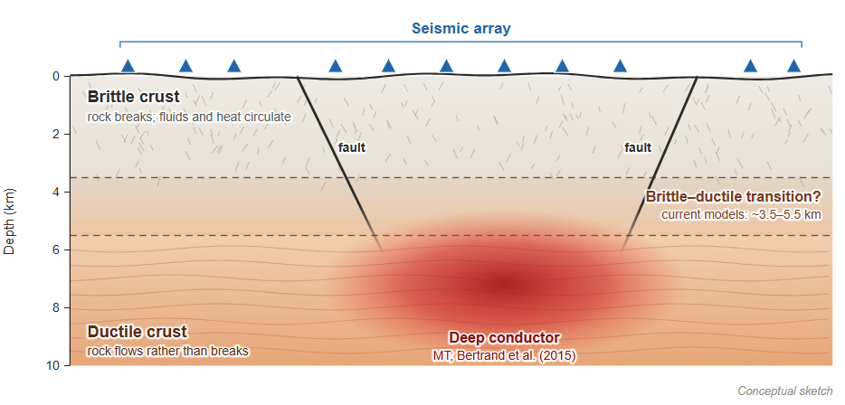
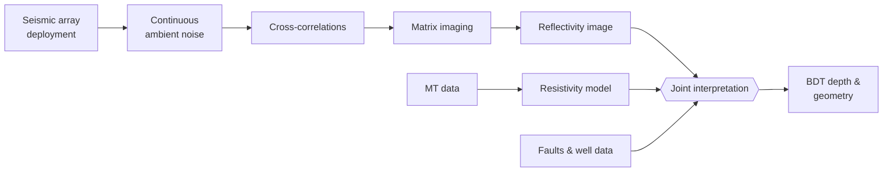
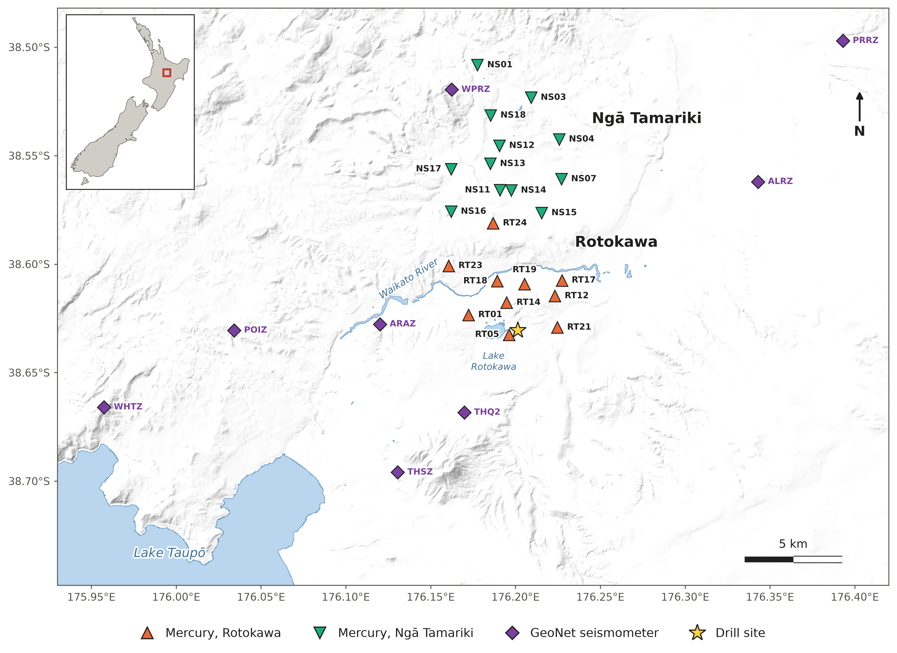

<h1 align="center">Imaging the brittle–ductile transition beneath Rotokawa</h1>

<p align="center">
  <em>Where does the crust stop breaking and start flowing, and what does that mean for deep geothermal energy?</em>
</p>

<p align="center">
  
</p>

## Overview

The **brittle–ductile transition (BDT)** is the depth where rock stops fracturing and starts to deform by flow. It
sets a lower limit on how deep fractures, fluids and heat can circulate, which matters for the next generation of
deep geothermal resources in Aotearoa New Zealand.

Beneath the **Rotokawa Geothermal Field** in the Taupō Volcanic Zone, the BDT has never been drilled, and current
estimates range from about **3.5 to 5.5 km**. This project uses a new seismic array and magnetotelluric (MT) data
to image it directly.

<p align="center">
  
  <br>
  <sub><b>Figure 1.</b> Conceptual sketch of the problem: where is the BDT, and how does it relate to the deep conductor and the faults?</sub>
</p>

## Research questions

**Main question:** Where is the brittle–ductile transition beneath Rotokawa, and does it follow the deep conductor
and the field's faults?

1. **Depth:** Can ambient-noise seismic imaging resolve a reflector or change in reflectivity at the BDT, and at what depth?
2. **Conductor:** Does the BDT coincide with the top of the deep conductor seen in MT resistivity models?
3. **Faults:** Does the BDT change depth across the field's major faults?

## Approach

I am deploying a new seismic array at Rotokawa and interpreting the results jointly with MT resistivity.

| Method | Data | What it constrains |
|---|---|---|
| **Seismic matrix imaging** | Ambient-noise cross-correlations from the new array | Reflectors at BDT depth |
| **Magnetotellurics (MT)** | Existing and new MT soundings | Resistivity structure, including the deep conductor |
| **Joint interpretation** | Both, plus fault maps and well data | BDT depth and its relationship to the conductor and faults |



## Study area

<p align="center">
  
  <br>
  <sub><b>Figure 2.</b> Rotokawa Geothermal Field, Taupō Volcanic Zone, with current seismic stations.</sub>
</p>

## Project status

- [ ] Array design and site selection
- [ ] Seismic array deployment
- [ ] Data processing and cross-correlations
- [ ] Matrix imaging
- [ ] MT modelling
- [ ] Joint interpretation
- [ ] Thesis write-up

## Repository structure

```
.
├── data/          # data (not publicly available)
├── figures/       # figures used in this README and in publications
├── notebooks/     # Jupyter notebooks for exploratory analysis
└── README.md
```

## Outputs

GSNZ 2026: [Project abstract](docs/GSNZ2026_Abstarct.md); [Poster](docs/GSNZ2026-Poster.pdf)

## People

**Julia Berglind**, PhD candidate, Victoria University of Wellington with Earth Sciences New Zealand (ESNZ)

**Supervisors**
- Finnigan Illsley-Kemp, Victoria University of Wellington
- Alison Kirkby, Earth Sciences New Zealand

## Acknowledgements

This work is part of the [DeepHeat](https://geothermalnextgeneration.com/) programme, funded by the Ministry of
Business, Innovation and Employment (MBIE). Data are provided by GeoNet, ESNZ and Mercury.

## Contact

Questions or interested in collaborating? Feel free to get in touch!

- **Email:** [Julia.Berglind@vuw.ac.nz](mailto:Julia.Berglind@vuw.ac.nz)
- **LinkedIn:** [julia-berglind](https://www.linkedin.com/in/julia-berglind/)
